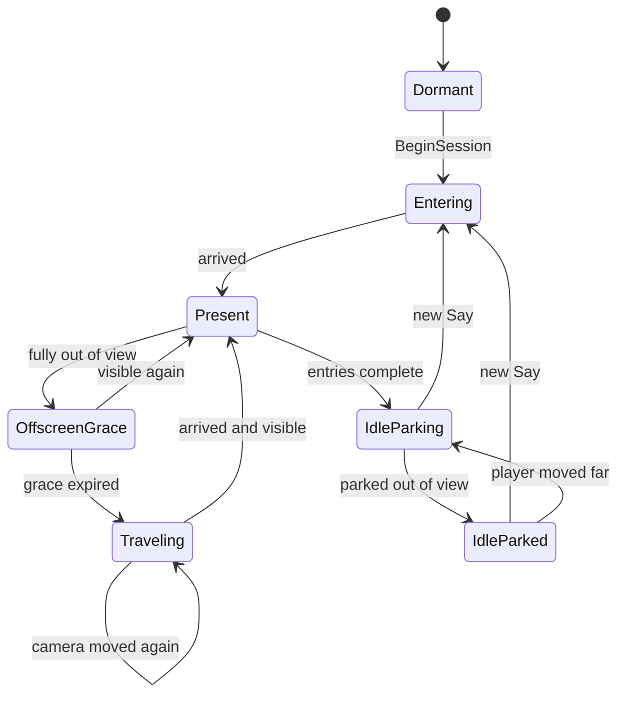

# TTS Voice Panel - Camera Operator Companion

**Status:** backlog - design only. No runtime code is changed in this step.

**Related:** [`universe-views-and-interaction.md`](../../done/universe-views-and-interaction.md), [`universe-transform.md`](../../done/universe-transform.md)

## 1. Goal

Turn the TTS voice card into a persistent, character-like companion that behaves like a camera operator:

- It enters the player's view from the nearest edge: from the right if it is off to the right, from the top if it is above, and so on.
- Once in view it stays world-anchored at a comfortable lower-third position and keeps playing entries.
- When the player turns or moves away, it travels around the camera into view again instead of teleporting or head-locking.
- Speech stops while the panel is fully out of view and restarts the current entry from the beginning when the panel is seen again.
- Movement has a quiet spatial sound. Small movements do not make noise.
- It is always available as a low-key presence without occupying the center of the view or moving constantly.

The feature is a presentation and speech-gating change. It does not add new dialogue, voices, or localization.

## 2. Non-goals

- New written dialogue or voice recordings.
- Replacing the Jim avatar or expression art.
- Hand/controller grabbing, dragging, or physics on the panel.
- Full collision avoidance against room geometry and furniture.
- Persisting panel state across app sessions.
- Redesigning the game-end panel, store UI, or other panels.
- Rewriting the TTS provider or adding streaming TTS behavior.
- Changing the text/card design system.

## 3. Current behavior

- `TTSVoice` is a scene root in `Assets/_Game/Game.unity`. It has `LocalizedTTSVoice`, `MarkdownTTSVoiceWrapper`, `TTSHelper`, and `SubtitlesLikeFollow` on the same object.
- `SubtitlesLikeFollow` currently:
  - targets `camera.forward * 0.55` plus `-0.15` on Y (`Assets/_Modules/UI/Behaviours/SubtitlesLikeFollow.cs:21`);
  - `ShowInCameraView()` teleports and faces the camera (`:31`);
  - checks visibility by casting one ray along the camera forward against a 0.2 m sphere;
  - after 0.66 s out of view, tweens the panel toward the camera target (`:118`);
  - has an `isFollowing` toggle that `TTSHelper` drives.
- `TTSHelper.Say()` speaks a key and saves a cookie. `SetInFrontOfCameraOrDefault(bool)` either shows/follows or docks the panel at `defaultPoint` (`Assets/_Game/Features/TTS/Scripts/TTSHelper.cs:21` and `:40`).
- `GameStartState` enables following for the welcome message (`Assets/_Game/Flow/GameStartState/GameStartState.cs:90`). `EditionState` docks the panel at `TTSPoint` for the round intro (`Assets/_Game/Flow/EditionState/EditionState.cs:77`).
- `LocalizedTTSVoice` speaks entries one at a time in a coroutine, waits for `speaker.IsSpeaking`, then waits `entry.secsAfter` before advancing (`Assets/_Modules/TTS/Core/Scripts/LocalizedTTSVoice.cs:124`).
- `StreamingAssetsSpeaker` loads an MP3, plays it, waits its real length, and only supports `Stop`, not pause (`Assets/_Modules/TTS/Core/Scripts/Speakers/StreamingAssetsSpeaker.cs:45`).
- `GameEndPanel` also uses `SubtitlesLikeFollow.ShowInCameraView()` for its end-of-run panel (`Assets/_Game/Flow/GameEndState/GameEndPanel.cs:40`). That call must keep its current instant-placement behavior.
- `Jim` has idle expressions (`ExpressionId.Idle`) but no base avatar texture (`Assets/_Game/Features/TTS/Voices/VoiceId.Jim.asset`). Idle presentation must use the idle expression, not `avatar`.

## 4. Experience specification

### 4.1 Presence lifecycle

The companion has three states:

| State | What the player sees | Behaviour |
|---|---|---|
| **Dormant** | Nothing | Before the first session or when explicitly disabled |
| **Speaking** | Full card with avatar and text | Enters if needed, stays in view, speech plays |
| **Idle parked** | Nothing in view; the idle expression is held on the panel | Parks near the player, outside the view and hand volume |

A **session** starts on the first `TTSHelper.Say(...)`:

1. Cancel idle parking.
2. Enter from the nearest view edge if parked or out of view.
3. Speak the entries.
4. After the last entry, show the idle expression only.
5. Wait `idleParkDelaySecs`, then either stay put if the panel is already outside the view and hands, or move to a parking spot near the player that is outside both.
6. Stay parked until the next `Say`, or re-park if the player moves far away.

A new `Say` while idle cancels the parking and enters the view again.

This is the "always there" behavior: the companion persists and stays near the player, but while idle it is out of sight and out of the hands rather than hovering in front of the face. If the player deliberately looks at the parked spot, it stays there; it does not flee or jump back into view.

### 4.2 Anchoring

- Anchor in camera space: `(0, -yDistanceFromCenter, distanceToCamera)`.
- Defaults: `distanceToCamera = 0.55 m`, `yDistanceFromCenter = 0.15 m`.
- This keeps the card in the lower third and out of the main interaction area.
- The panel is **world-anchored**, not parented to the head. Small head rotation does not drag it.
- The panel always faces the camera around Y, with a small optional bank while moving.
- The **idle parking anchor** is separate: a near-player, camera-relative point outside the viewport and outside the hand interaction volume (see 4.9).
- The root transform is the authoritative anchor. Any idle bob or settle is applied to the child content transform so visibility and travel stay stable.

### 4.3 Reposition state machine



Rules:

- **Only fully out of view triggers a move while speaking.** Partial visibility is still visible.
- When the panel becomes fully out, start `offscreenGraceSecs`. If it becomes visible again during that window, cancel the move. This absorbs quick glances and head jitter.
- After the grace, start a travel. While traveling, the current entry is stopped and held; it restarts when any part of the panel is visible again.
- After the last entry, the panel does not stay in front of the player. It shows the idle expression, waits `idleParkDelaySecs`, then leaves the view through the nearest edge and parks outside the view and hands. If it is already outside both when the delay expires, it simply stays there.
- While parked, it stays put. It does not chase the view or re-enter on its own.
- If the player moves far enough that the parked spot is no longer near them, re-park to a new valid spot without entering the view.
- A `followCooldownSecs` after arrival prevents immediate re-triggering.
- Small camera translation does not trigger a full travel. If the panel is still visible but the camera has moved more than `followDeadzoneMeters`, follow smoothly with no movement sound.
- Large rotation triggers a travel because the panel leaves the view. The travel path approaches from the nearest view edge.
- If the camera moves substantially during a travel, finish the current path, then allow one correction hop. Do not loop endlessly.

### 4.4 Choosing the entry side

The entry side is based on where the panel currently is relative to the camera view, not on the camera's yaw alone.

1. Convert the panel center to camera-local space.
2. If it is in front, normalize X and Y by the frustum half-extents at that depth:
   - `nx = local.x / (local.z * tanHalfFovY * aspect)`
   - `ny = local.y / (local.z * tanHalfFovY)`
   - `nx` and `ny` are roughly in `[-1, 1]` at the view edges.
3. Subtract the safe margins. The side with the largest overflow is the entry side. Ties prefer horizontal.
4. If the panel is behind the camera (`local.z <= 0`), use its horizontal sign:
   - right if `local.x >= 0`, left otherwise;
   - use top/bottom only when `abs(local.y)` clearly dominates `abs(local.x)`.
5. Behind the camera uses a larger travel radius so the path swings around the player rather than through them.

| Current panel position | Entry side |
|---|---|
| Mostly right | Right edge |
| Mostly left | Left edge |
| Mostly above | Top edge |
| Mostly below | Bottom edge |
| Behind-right | Right edge with a wider swing |
| Behind-left | Left edge with a wider swing |
| Behind and near center | Nearest horizontal side, one extra hop if needed |

The panel never crosses the center of the view to reach its target. It stays near the selected edge until the final settle.

### 4.5 Travel path

```text
current
  -> swing point (outside the FOV, on the selected side)
  -> entry staging point (just outside the safe view rectangle)
  -> lower-third anchor
```

- If the panel is already on the selected side and outside the view, skip the swing point.
- If the panel is already visible (for example, the player is looking at its parked spot), use a short fade/scale show rather than a long orbit.
- The swing and staging points are computed in camera space at travel start, then converted to world space. This makes the movement feel like it happens in the room, not like the panel is glued to the head.
- Travel uses smooth ease-in-out, no overshoot.
- `travelSecs` scales with the angular distance, clamped to a comfortable range. A 180-degree swing takes longer than a 20-degree nudge, but never snaps.
- The panel faces the camera throughout the travel and settles facing the camera on arrival.
- Optional: a small roll/bank into the direction of motion, capped at a few degrees, for personality.

### 4.6 Visibility

Visibility is generous: the player must be able to see at least part of the panel.

- Sample the panel center and four corners, or a conservative world-space bounds.
- The panel is visible when at least one sample:
  - is in front of the camera;
  - projects inside the viewport (not the safe rect; the full viewport);
  - is not blocked by room geometry.
- Occlusion uses short rays from the camera to the sample points, against a configurable environment mask. Hits on the panel's own colliders are ignored.
- If the occlusion setup is missing or ambiguous, treat the panel as visible. It is better to keep an entry playing than to stop and restart it because of a bad mask.
- Run the check at `visibilityCheckSecs` (about 10 Hz), not every frame.
- Use hysteresis:
  - `fullyOut` must remain true for `offscreenGraceSecs` before pausing/travelling.
  - `visible` must remain true for `restartGraceSecs` before restarting the current entry.

### 4.7 Speech interruption and restart

When the panel is confirmed fully out of view (after `offscreenGraceSecs`), stop the current entry's audio and remember the current entry index. Do not advance the sequence. A quick glance that returns within the grace does not interrupt the entry. When the panel is visible again for `restartGraceSecs`, restart that same entry from the beginning.

Restarting is preferred over mid-word pause/resume:

- no dependency on audio pause timing or clip position;
- no fixed real-time wait that can finish while the panel is hidden;
- the character always starts a sentence cleanly when it gets the player's attention again;
- `StreamingAssetsSpeaker.Stop()` already cancels both playback and loading.

Speech is gated on `IsInView`, not on travel completion. Entry travel is short and should feel almost instantaneous. The first entry does not start while the panel is parked or offscreen.

Implementation:

- `LocalizedTTSVoice`:
  - Add `SetVisible(bool)` and an `isInterrupted` flag.
  - Add a private `InterruptCurrentEntry()` that stops `waitRoutine` and the speaker without clearing `entries`, `index`, `onComplete`, or `retainPanelOnComplete`.
  - On hide: call `InterruptCurrentEntry()` and set `isInterrupted`.
  - On show: if interrupted, clear the flag and restart the current entry with `Speak(entries[index])`.
  - Guard `OnEntryComplete()` so a hidden or cancelled entry cannot advance the index.
  - Clear the interrupted state in `Stop()`.
  - Use a generation token or equivalent so callbacks from a cancelled coroutine cannot advance or complete the sequence twice.
- `TTSHelper`:
  - Subscribes to `InViewChanged` in `OnEnable` and unsubscribes in `OnDisable`.
  - While a session is active, calls `SetVisible(inView)` on the active `LocalizedTTSVoice`.
  - On session start, seeds visibility before calling `Speak`.
  - On a new `Say` while the old voice is active, the existing `Speak`/`Stop` path cancels the old entry cleanly.
- `BaseTTSSpeaker` and `StreamingAssetsSpeaker` do not need pause APIs. The current `Stop()` path is enough.

Semantics:

| Situation | Speech | Entry advance |
|---|---|---|
| Visible and speaking | Plays | Continues normally |
| Fully out of view | Stops the current entry | Holds at the current index |
| Traveling back into view | Silent | Holds |
| Visible again | Restarts the current entry from the beginning | Continues when that entry completes |
| Between entries while out of view or traveling | Silent | Does not start the next entry |
| Skip pressed | Stops | Completes the sequence callback |
| Session ends while out of view | Stops or remains parked | No further entries |

If the panel is visible mid-travel, restart the entry immediately. The travel is short enough that waiting for it to settle would add unnecessary silence.

### 4.8 Movement sound

- Add a dedicated `AudioSource` on the `TTSVoice` root, separate from the speech speaker.
- Use an SFX mixer group, spatial blend 1, no play-on-awake.
- Add a short soft servo/whoosh clip under `Assets/_Game/Features/TTS/Audio/`.
- Play it once when a travel starts.
- Do not play it for smooth follow, for travel under `moveSfxMinAngleDeg`, or while the panel is already visible and only being nudged.
- Volume scales gently with travel distance, with a low default so it never masks speech.
- Pitch has a small random variation.
- Stop or let the one-shot finish on arrival; do not loop.
- Optional arrival tick, very quiet, never on tiny moves.
- Optional Meta XR spatialization on the movement source if plain 3D panning is not convincing.

### 4.9 Idle parking and personality

- After the last entry, show the idle expression only. No text.
- Use `VoiceId.expressions` with `ExpressionId.Idle`, falling back to `avatar`, then to the last shown expression.
- Hold that idle pose for `idleParkDelaySecs` so the player sees the character settle rather than vanish instantly.
- If the panel is already outside the view and outside the hand volume when the delay expires, leave it where it is.
- Otherwise, move to a parking spot near the player that is outside the view and outside the hand interaction volume.
- Use the same nearest-edge logic in reverse for the parking travel: leave through the nearest view edge, never across the center.
- Do not play movement sound for parking. Idle should be silent.
- Parking candidates:
  - camera-relative spots at roughly arm's length, to the lower-left and lower-right of the player;
  - reject candidates inside the expanded viewport, inside the hand-safe volume, or behind room geometry;
  - choose the valid candidate nearest the panel's previous position;
  - fall back to a fixed lower-side offset if both candidates are invalid.
- While parked, stay world-anchored. Do not chase the view. Re-park only if the player moves more than `idleReparkDistance`, or if the current spot becomes invalid.
- If the player deliberately looks toward the parked spot, do not flee or re-enter the view. It waits for the next `Say`.
- If no idle expression exists, park the panel anyway; it remains a silent object until the next `Say`.
- Optional breathing/sway only while speaking and in view. No bob while parked.

### 4.10 "Not annoying" budget

- Never cover the center of the view; anchor below center.
- Never head-lock: stay world-anchored while visible.
- No follow movement while fully visible; the only deliberate move is leaving to park after entries.
- No movement for small camera jitter.
- No sound for small moves.
- At most one correction hop after a miss.
- Cooldown after arrival.
- Idle parks outside the view and hand volume; it never hovers in front of the face while silent.
- Idle parking is silent and does not chase head motion.
- Interruption is generous and restarts quickly; do not leave the player in silence after they look back.
- Movement speed is bounded and the path stays near the view edge.

## 5. Architecture

### 5.1 Components and files

| File | Change |
|---|---|
| `Assets/_Modules/UI/Behaviours/PanelViewport.cs` | New focused helper. Pure camera-space math: anchor, viewport coordinates, visibility samples, entry side, staging point, parking-candidate selection, and the hand-safe volume. |
| `Assets/_Modules/UI/Behaviours/PanelTravel.cs` | New focused helper. Travel state, arc path, duration, easing, arrival event. Advanced by the owning behaviour's update; no scene component required. |
| `Assets/_Modules/UI/Behaviours/SubtitlesLikeFollow.cs` | Keep the component name for scene and `GameEndPanel` compatibility. Refactor internals into presence/follow orchestration, visibility polling, idle parking, idle sway, and movement sound trigger. Keep under 250 lines by using the two helpers. |
| `Assets/_Game/Features/TTS/Scripts/TTSHelper.cs` | Own the session lifecycle. Start/end sessions, park after entries, subscribe to visibility, restart the active entry when the panel returns, remove the old front-of-camera toggle usage. |
| `Assets/_Modules/TTS/Core/Scripts/LocalizedTTSVoice.cs` | Interrupted-entry state, `SetVisible`, restart-current-entry behavior, and idle-expression presentation. |
| `Assets/_Modules/TTS/Core/Scripts/Speakers/BaseTTSSpeaker.cs` | No change. |
| `Assets/_Modules/TTS/Core/Scripts/Speakers/StreamingAssetsSpeaker.cs` | No change. Existing `Stop()` cancels playback and loading; restart uses it. |
| `Assets/_Game/Flow/GameStartState/GameStartState.cs` | Remove the explicit `SetInFrontOfCameraOrDefault(true)` call. |
| `Assets/_Game/Flow/EditionState/EditionState.cs` | Remove the explicit `SetInFrontOfCameraOrDefault(false)` call. |
| `Assets/_Game/Flow/GameEndState/GameEndPanel.cs` | No behavior change. It keeps using the instant `ShowInCameraView()`. |
| `Assets/_Game/Game.unity` | Wire the new tuning fields, camera/occlusion references, idle presentation, and movement AudioSource. |

`VoicesPlayer` and `SequencePlayer` do not need changes for the current game, because `TTSHelper` uses the wrapper directly. If they are later used with the same panel, the interrupted-entry state on `LocalizedTTSVoice` still applies.

### 5.2 Public API

`SubtitlesLikeFollow` (or its replacement surface):

```csharp
bool IsInView { get; }
event Action<bool> InViewChanged;

void BeginSession();
void EndSession();
void ShowInCameraView();      // instant; kept for GameEndPanel
void ShowInViewAnimated();    // new session/travel entry
```

`LocalizedTTSVoice`:

```csharp
void SetVisible(bool visible); // stops on hide; restarts current entry on show
void ShowIdle();
```

`TTSHelper`:

```csharp
void Say(string key, Action onComplete); // begins/ends the session internally
```

### 5.3 Flow

```text
GameStartState / EditionState
        |
        v
TTSHelper.Say(key, onComplete)
        |
        +--> SubtitlesLikeFollow.BeginSession()
        |       - cancel idle
        |       - choose entry side
        |       - travel if needed
        |       - expose InViewChanged
        |
        +--> MarkdownTTSVoiceWrapper.Speak(..., retainPanelOnComplete: true)
        |       - LocalizedTTSVoice speaks entries
        |       - InViewChanged -> SetVisible(inView)
        |       - hide: stop current entry and hold its index
        |       - show: restart that entry from the beginning
        |
        +--> onComplete
                - show idle expression
                - wait idleParkDelaySecs
                - park outside view and hands
                - stay parked until the next Say
```

`EndSession()` is only used for an explicit stop or disable. Finishing entries parks the companion; it does not destroy or fade out the session.

### 5.4 Visibility ownership

`SubtitlesLikeFollow` owns visibility and knows nothing about TTS. `TTSHelper` owns the binding between visibility and speech. This keeps the UI behaviour reusable for `GameEndPanel` and keeps speech semantics in the TTS layer.

## 6. Implementation slices

### Slice 1 - Visibility restart plumbing

1. Add `SetVisible(bool)` and the interrupted-entry state to `LocalizedTTSVoice`.
2. Ensure hide stops the current entry and keeps the index, and show restarts that entry.
3. Guard against duplicate completion: a cancelled routine or stopped speaker must not advance the sequence or invoke `onComplete` twice.
4. Add a temporary debug toggle or inspector button to simulate visible/hidden.
5. Verify that hide mid-entry stops audio, show restarts the same entry, and the next entry only starts after the restarted entry completes while visible.

No panel movement and no speaker pause API in this slice. If this slice is not solid, do not build movement on top of it.

### Slice 2 - Viewport and visibility

1. Add `PanelViewport` with pure methods for anchor, viewport coordinates, visibility samples, and entry side.
2. Refactor `SubtitlesLikeFollow` to use it.
3. Expose `IsInView` and `InViewChanged`.
4. Add scene gizmos for the safe rect and chosen entry side.
5. Test classification around the view edges, above/below, and behind the camera.

This slice can still use the existing teleport placement. The goal is correct classification before motion.

### Slice 3 - Travel and state machine

1. Add `PanelTravel` with swing/staging/anchor path and duration.
2. Add present/offscreen-grace/traveling/cooldown states to `SubtitlesLikeFollow`.
3. Keep `ShowInCameraView()` instant for `GameEndPanel`; use animated entry for TTS sessions.
4. Add translation deadzone follow for physical walking.
5. Add one correction hop after a missed target.

### Slice 4 - Personality, parking, and sound

1. Add idle expression presentation to `LocalizedTTSVoice`.
2. Add parking-candidate selection and the camera-relative hand-safe volume to `PanelViewport`.
3. Add the idle-park state and park travel to `SubtitlesLikeFollow`.
4. Add breathing/sway to the content transform only while speaking and in view.
5. Add the movement AudioSource, clip, volume, cooldown, and minimum angle. Do not play it for parking.
6. Tune parking distance, side offsets, and hand clearance in the XR simulator and headset.

### Slice 5 - Session integration

1. Make `TTSHelper.Say` begin the session, and park the companion after the last entry.
2. Keep `EndSession()` for explicit stop/disable only.
3. Subscribe/unsubscribe visibility events with correct enable/disable pairing.
4. Seed visibility from the current `IsInView` on session start.
5. Remove the `SetInFrontOfCameraOrDefault` calls from `GameStartState` and `EditionState`.
6. Remove the now-unused method or keep it only if a real caller remains.
7. Verify welcome, round intro, multi-entry sequences, skip, parking, and game end.

### Slice 6 - Tuning and cleanup

1. Remove dead fields and the old follow flag if it is no longer used.
2. Check the 250-line type and 25-line method limits.
3. Remove LINQ, name lookups, and per-frame allocations.
4. Verify mixer routing and the Meta XR audio setup.
5. Validate comfort and "not annoying" behavior in the headset.

## 7. Tuning defaults

| Parameter | Default | Why |
|---|---:|---|
| `distanceToCamera` | 0.55 m | Existing comfortable distance |
| `yDistanceFromCenter` | 0.15 m | Existing lower-third position |
| `safeViewportX` | 0.82 | Keeps the card away from the edge |
| `safeViewportY` | 0.78 | Avoids clipping at top/bottom |
| `offscreenGraceSecs` | 0.30 | Absorbs quick glances |
| `restartGraceSecs` | 0.12 | Restarts quickly when seen |
| `followCooldownSecs` | 0.60 | Prevents chase loops |
| `visibilityCheckSecs` | 0.10 | Cheap and responsive |
| `followDeadzoneMeters` | 0.12 | Ignores head/body micro-motion |
| `minTravelAngleDeg` | 8 | No travel for tiny offsets |
| `travelSpeedDegPerSec` | 240 | Bounded, camera-like swing |
| `minTravelSecs` | 0.35 | No snap |
| `maxTravelSecs` | 0.90 | Not slow enough to feel laggy |
| `behindRadiusPadding` | 0.15 m | Swings clear of the player |
| `moveSfxMinAngleDeg` | 10 | No sound for small corrections |
| `moveSfxVolume` | 0.20-0.30 | Never masks speech |
| `idleParkDelaySecs` | 0.60 | Lets the idle pose register before parking |
| `idleParkForward` | 0.45 m | Keeps the parked panel near the player |
| `idleParkSideOffset` | 0.45 m | Lower-side parking candidates |
| `idleParkDownOffset` | 0.38 m | Below the view |
| `idleParkViewportMargin` | 0.15 | Rejects parking spots still in view |
| `idleReparkDistance` | 0.75 m | Re-parks only when the player really moves |
| `handSafeHalfWidth` | 0.30 m | Keeps parking out of the hand workspace |
| `handSafeForwardMin` | 0.15 m | Hand volume begins in front of the chest |
| `handSafeForwardMax` | 0.65 m | Hand volume ends near arm's length |
| `idleBobAmplitude` | 0.004 m | Barely perceptible while speaking |
| `idleBobSecs` | 4 | Slow breathing rhythm |
| `maxCorrectionHops` | 1 | Avoids endless chasing |

All float time knobs use `Secs` or `secs` in the name.

## 8. Scene wiring

- Add a movement `AudioSource` to `TTSVoice`:
  - `playOnAwake = false`
  - `spatialBlend = 1`
  - SFX mixer group
  - low volume
  - short max distance
- Add the movement clip reference to the panel behaviour, not to the speaker.
- Add an optional camera reference for the follow behaviour. Fall back to `Camera.main` only for compatibility; prefer explicit scene wiring.
- Move the panel trigger collider to the UI layer and exclude UI from the occlusion mask.
- The existing trigger sphere stays as the panel's rough bounds. Add sample extents for the four corners, or use a conservative bounds source.
- Add idle expression wiring only through `VoiceId`; no new art is required for Jim.
- Add parking tuning fields: forward/side/down offsets, hand-safe volume, viewport margin, and re-park distance.
- Add optional gizmos for the safe rect, chosen side, staging point, travel path, parking candidates, and hand-safe volume.

## 9. Test plan

There is no test assembly in the project. Validate in Unity Play Mode and on the headset.

### Speech interruption

- Look away mid-sentence: audio stops within the grace window, the index stays on the current entry, and no next entry starts.
- Look back: the same entry restarts from the beginning while the panel enters.
- Look away during `secsAfter`: the sequence holds on the current entry and restarts it when visible.
- Look away before the first entry: nothing plays until the panel is visible.
- Press skip while hidden: the sequence completes once, with no restarted audio.
- Start a new `Say` while the old entry is interrupted: the old entry is canceled, not layered.
- Call `Stop`: no audio restarts and the interrupted state is cleared.
- A cancelled coroutine or stopped speaker never advances the index or invokes `onComplete` twice.

### Entry and follow

- Start a session while the panel is left of view: it enters from the left.
- Start while it is right: enters from the right.
- Start while it is above/below: enters from the top/bottom.
- Turn 90 degrees: the panel leaves the view, waits for the grace, then enters from the new nearest edge.
- Turn 180 degrees: the panel swings around a side, never across the center.
- Turn back quickly during the grace: no travel occurs.
- Walk physically while visible: the panel follows with the translation deadzone and no travel sound.
- Keep rotating repeatedly: the cooldown prevents a constant chase.
- Put a wall between the camera and panel: the panel is treated as out of view and the current entry restarts when visible.

### Personality and audio

- Movement sound plays once per real travel and is spatial from the entry side.
- Small corrections and smooth follow are silent.
- Idle expression appears after the last entry and has no text.
- After `idleParkDelaySecs`, the panel parks outside the view and outside the hand volume.
- Parking leaves through the nearest view edge and is silent.
- Looking directly at the parked spot does not make it flee or re-enter the view.
- The next `Say` brings it back in from the nearest view edge.
- Walking more than `idleReparkDistance` re-parks it near the player, still out of view and hands.
- Breathing is not noticeable as motion sickness while speaking.
- The panel never sits in the center of the view or covers the main interaction area.

### Compatibility

- `GameEndPanel.Show()` still places its panel instantly and works as before.
- Welcome and round-intro flows still complete and advance state.
- No duplicate panel, no double `onComplete`, no leaked event subscriptions.
- No camera (`Camera.main == null`) does not crash; speech still runs.
- Multiple localization tables and empty entries still behave as before.

## 10. Risks

- **VR comfort:** A moving panel in the center of view can be uncomfortable. The design keeps motion peripheral, bounded, and never crosses the center.
- **Restart race:** Stopping the current entry while its coroutine is still unwinding can accidentally advance the index or call `onComplete` twice. Use a generation guard and test the hide/show path first.
- **Moving target:** The camera can move during travel. Finish the current path and allow one correction hop; do not retarget every frame.
- **Occlusion false negatives:** A bad layer mask can stop and restart speech while the panel is visible. Default to visible on ambiguity.
- **Idle parking feels like disappearing:** The panel can read as "leaving the stage" rather than despawning if it holds the idle pose briefly, parks nearby, and returns from the same side. Keep a parking gizmo for tuning.
- **Parking invalid at runtime:** A chosen spot can become blocked or inside the player's reach. Re-evaluate candidates on re-park and fall back to the opposite side.
- **Shared component:** `SubtitlesLikeFollow` also serves the game-end panel. Preserve the instant `ShowInCameraView()` path.
- **Multiple voices:** The current game has one voice. If `VoicesPlayer` starts driving multiple voices, visibility must be applied to the active voice, not the component.

### 10.1 Risks to resolve before coding

These can invalidate the design or cause a visible regression if left to the end:

| Risk | Why it must be solved now | Planned resolution |
|---|---|---|
| Speech starts while parked or offscreen | The speaker is spatial and attached to the panel. The first words could come from the parked location and then sweep through the room. | Gate speech on `IsInView`, not on travel completion. Entry travel is short; seed visibility before calling `Speak`. |
| Restart double-advance | Stopping a coroutine and restarting the same entry can race the old completion callback. | Use a generation token in `LocalizedTTSVoice`; ignore callbacks from cancelled routines. Test hide/show before any movement work. |
| No valid parking spot | Tight rooms, walls, floor, or hands can make every candidate invalid. The panel is small, but this still needs a fallback. | Check candidate clearance with `Physics.CheckSphere`, clamp above the floor, then fall back to the last valid spot, then a lower-side offset, then staying put. |
| Panel collider corrupts occlusion | The panel's own trigger is on the default layer and will be hit by visibility rays. | Move the panel trigger collider to the UI layer and exclude UI from the occlusion mask. Treat ambiguous checks as visible. |
| Travel causes discomfort | Center-crossing or fast motion in VR can make the feature unusable even if it works. | Keep the path peripheral, cap angular speed, never cross the center, allow one correction hop, and test early in the headset. |
| Shared `SubtitlesLikeFollow` regression | `GameEndPanel` depends on the same component. | Keep `ShowInCameraView()` instant and side-effect free. Use the animated/session path only for TTS. |

Not blockers for now: movement clip selection, exact hand-volume tuning, and multiple-voice support. The current game has one active voice.

## 11. Open questions

1. **Movement sound:** Use a soft servo/whoosh, a short UI chime, or silence? The plan recommends a quiet servo/whoosh under the SFX group.
2. **Physical walking:** Should the panel follow when the player walks, or only when the view direction changes? The plan recommends following with a deadzone and no travel sound.
3. **Occlusion:** Should a wall between the player and the panel stop and restart the current entry? The plan recommends yes, with a generous fallback.
4. **Top/bottom entry:** Confirm that entering from above or below is wanted, not just left/right. The request suggests yes, but this is the main place where the camera-operator feel can become distracting.
